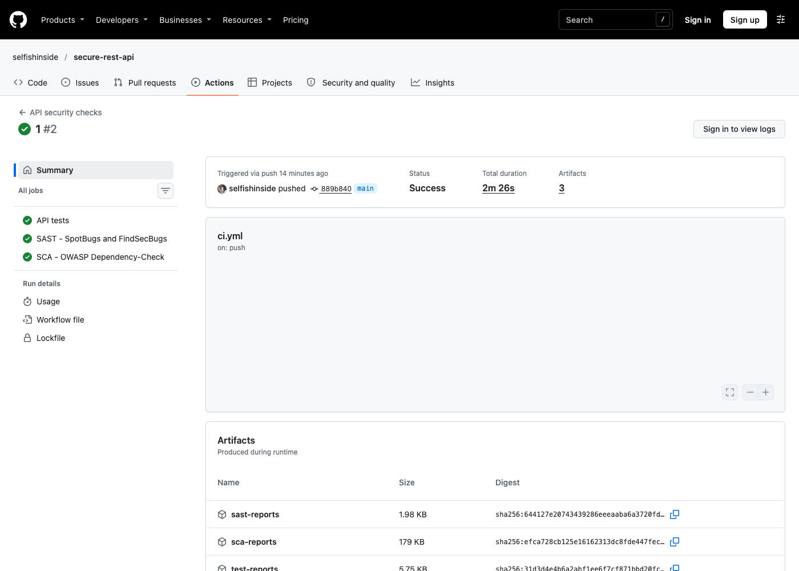

# Лабораторная работа №1

**Разработка защищённого REST API с интеграцией в CI/CD**

Репозиторий: https://github.com/selfishinside/secure-rest-api

Проверенный успешный запуск CI: https://github.com/selfishinside/secure-rest-api/actions/runs/42838025696

Учебный проект по разработке защищённого REST API на Java Spring Boot с автоматическими проверками безопасности в GitHub Actions.

## Стек

- Java 17
- Spring Boot 3.4.13
- Spring Security
- Spring Data JPA и Hibernate
- H2 Database
- Maven
- JWT
- SpotBugs и FindSecBugs
- OWASP Dependency-Check

## Запуск

Для запуска приложения выполните:

```bash
./mvnw spring-boot:run
```

Приложение доступно по адресу `http://localhost:8080`.

Для проверки проекта используются команды:

```bash
./mvnw clean test
./mvnw compile spotbugs:check
./mvnw dependency-check:check
```

## Методы API

### POST /auth/login

Метод выполняет аутентификацию пользователя и возвращает JWT-токен.

Пример запроса:

```json
{
  "username": "admin",
  "password": "admin123"
}
```

Пример команды:

```bash
curl -X POST http://localhost:8080/auth/login \
  -H "Content-Type: application/json" \
  -d '{"username":"admin","password":"admin123"}'
```

### GET /api/data

Возвращает записи из базы данных. Endpoint доступен только с действующим JWT-токеном.

```bash
curl http://localhost:8080/api/data \
  -H "Authorization: Bearer <JWT-токен>"
```

### POST /api/data

Создаёт новую запись в базе данных. Требуется JWT-токен.

```json
{
  "title": "Тестовая запись",
  "content": "Содержимое записи"
}
```

```bash
curl -X POST http://localhost:8080/api/data \
  -H "Content-Type: application/json" \
  -H "Authorization: Bearer <JWT-токен>" \
  -d '{"title":"Тестовая запись","content":"Содержимое записи"}'
```

## Реализованные меры защиты

### Аутентификация и JWT

После проверки логина и пароля сервер выдаёт подписанный JWT-токен. `JwtAuthenticationFilter` извлекает Bearer-токен из заголовка `Authorization`, проверяет его подпись и срок действия, а затем устанавливает аутентифицированного пользователя в контекст Spring Security. Все endpoint-ы, кроме `/auth/**`, требуют успешной аутентификации.

### Защита пароля

Пароль не хранится в открытом виде. В приложении используется BCrypt-хэш. При входе Spring Security сравнивает переданный пароль с сохранённым хэшем через `PasswordEncoder`.

### Защита от SQL-инъекций

Для работы с H2 используется Spring Data JPA и Hibernate. Данные сохраняются через `JpaRepository`, поэтому SQL-запросы не формируются конкатенацией строк с пользовательским вводом.

### Защита от XSS

Перед возвратом пользовательских данных API экранирует HTML-символы с помощью `HtmlUtils.htmlEscape`. Например, строка `<script>alert(1)</script>` возвращается как безопасный текст `&lt;script&gt;alert(1)&lt;/script&gt;`.

### Валидация данных

Поля запроса проверяются аннотацией `@NotBlank`. Пустые значения отклоняются с ответом `400 Bad Request`.

### Защита сессии

Приложение использует stateless-аутентификацию через JWT и не хранит серверные сессии. CSRF-проверка не отключена глобально: для stateless API-маршрутов `/auth/**` и `/api/**` задано точечное исключение.

## CI/CD

Workflow расположен в `.github/workflows/ci.yml` и запускается при каждом `push`, `pull request` или вручную через `workflow_dispatch`.

Pipeline разделён на три независимые задачи:

1. `API tests` — сборка и автоматические тесты API.
2. `SAST - SpotBugs and FindSecBugs` — статический анализ исходного кода и поиск типичных ошибок безопасности.
3. `SCA - OWASP Dependency-Check` — проверка зависимостей на известные уязвимости.

Результаты тестов и отчёты SAST/SCA сохраняются в разделе Artifacts соответствующего запуска GitHub Actions.

### Результаты SAST и SCA



[SAST](https://github.com/selfishinside/secure-rest-api/actions/runs/42838025696/job/129905352067) · [SCA](https://github.com/selfishinside/secure-rest-api/actions/runs/42838025696/job/129905352787)

Порог `failBuildOnCVSS=11` означает, что обнаруженные CVE не блокируют сборку (максимум CVSS — 10). Успешный SCA подтверждает выполнение анализа, а не отсутствие уязвимостей.

## Проверка API

Автоматические тесты проверяют:

- успешную выдачу JWT при корректных данных;
- отказ в доступе к `/api/data` без токена;
- доступ к защищённому endpoint с действующим токеном;
- создание записи в H2 через JPA;
- отклонение пустых полей;
- экранирование HTML-тегов в ответе API.

## Фрагменты реализации

```java
public interface DataRepository extends JpaRepository<SecureData, Long> {
}
```

```java
result.put("content", HtmlUtils.htmlEscape(item.getContent()));
```

```java
@Bean
public PasswordEncoder passwordEncoder() {
    return new BCryptPasswordEncoder();
}
```

JWT содержит `sub`, `iat` и `exp`; срок действия в конфигурации — один час. Пользователь хранится в `InMemoryUserDetailsManager`, записи — в H2. GET возвращает общий список; изоляция по владельцу не реализована. Данные демонстрационного входа и ключ JWT необходимо заменить перед эксплуатацией. Экранирование применяется для HTML-текста; клиент также должен безопасно отображать JSON.

Успешные GET и POST возвращают 200; POST возвращает `id` и `message`, GET — массив `id`, `title`, `content`, `createdBy`. Вход возвращает JWT в поле `token`. Без авторизации GET возвращает 401; пустые поля при корректном JWT — 400.
